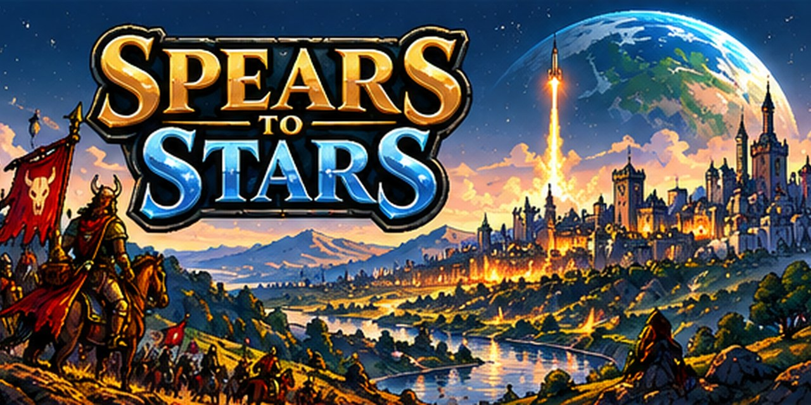

# Spears to Stars



A twenty-minute civilization. Vampire Survivors meets Civilization: lead your people from spears to starships, draft troop lines as you level, conquer the map, and hold your capital through the Decline and Fall.

Built entirely through prompting by Tim Berube.

## Play it

- **Online:** https://berubett-hue.github.io/Spears-to-stars/ (works on phone and PC, nothing to install). On a phone, use Share → Add to Home Screen to play it fullscreen like an app.
- **Locally:** the game is plain HTML, CSS and JavaScript with no build step. Browsers block some features when a page is opened straight from disk, so serve the folder:

  ```
  python3 -m http.server 8000
  ```

  Then open http://localhost:8000 in a browser.

## Folder layout

```
index.html        the page: HUD and menus markup, loads everything else
css/style.css     all styles (HUD frames, menus, phone layouts)
js/               the game, split by system, loaded in this order:
  01-data-troops.js        troop lines, forms, constants
  02-progress.js           secret lines, Legacy, mastery, evolution hunt
  03-peoples.js            heroes, peoples, borders
  04-map.js                terrain, exploration, loot
  05-art.js                sprite-sheet layouts (which frame is where)
  06-state.js              game state, new game
  07-economy.js            economy, Space Program
  08-buildings-raids.js    buildings, barbarian raids
  09-combat.js             combat
  10-cities-diplomacy.js   capturing cities, diplomacy
  11-update-draft.js       main update, level-up draft, ages, hidden peoples, big moments
  12-events-meta.js        events, decrees, morale, grades, quests, unlock progress, artifacts
  13-decline.js            Decline and Fall
  13s-strongholds.js       hidden strongholds of the six hidden peoples
  13g-governments.js       a government choice at the start and each new age
  13r-sites.js             resource sites worth fighting over
  13h-horde.js             the Red Horde, a rare barbarian empire
  13v-prosperity.js        the Prosperity victory (a Golden Age you hold for 90 seconds)
  14-fx-audio.js           effects, sound, generative music
  15-render.js             pixel art, troop forms, map rendering
  16-hud.js                HUD, damage meter, goals, battles, diplomacy panel, ledger
  16v-victory.js           the Win tab and closest-win chip: progress on all four ways to win
  17-arena.js              Proving Grounds
  18-menu.js               main menu
  18p-phone.js             phones: layout switch, one message at a time, joystick, vibration, battery mode
  18t-tips.js              one-time tips that light up a button and explain it
  19-main.js               game loop, input, boot
art/              every image and the pixel font, grouped by use
  sprites/                 the big sheets (troops, generals, cities, barbarians, map tiles, effects)
  hud/  ui/                in-game HUD icons and frames
  manifest.json            list of every art file and its size
  governments/ resources/ horde/   art for governments, resource sites and the Red Horde
  store/                   logo, app icon and wide banners for store pages and sharing
tools/            developer tools (Node)
```

## Rules for the code

- The JavaScript files share one global scope and must load in numeric order. A function can be *called while the page loads* only if it is defined in the same file or an earlier one.
- Image loaders that call back into the game are queued with `atBoot(...)` so they start after every file has loaded.
- Unlock pace: the four ways to win each bring a people, in-game feats count from Crown 1, every Crown win has a reward (`REGALIA` in `js/02-progress.js`), and the Collection keeps a per-people record of win kinds and best Crown.
- Saves are kept across updates. `SAVE_VER` in `js/02-progress.js` wipes everyone's unlocks, Glory and Crowns once when it changes, so it only changes when Tim asks for a reset for a big content update.
- After changing the order or moving code between files, run the checks:

  ```
  cd tools && npm install && npm run check
  ```

## Balance simulations

```
cd tools
node sim-decline.js .. legion 600    # play to 10:00, hand over the map, run the Decline
node sim-troops.js .. horde          # army size, spawns and upkeep through the late game
```

## License

© 2026 Tim Berube. All rights reserved. You're welcome to play the game and read the source, but not to copy, modify, re-host or redistribute it. See [LICENSE](LICENSE).
